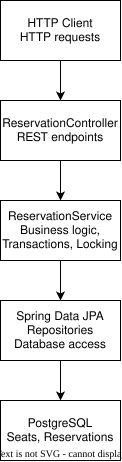

# reservation-engine

## 1. Overview
Reservation Engine is a backend application that manages seating for events, allowing temporary seat holds and confirmed reservations.

The engine uses database transactions and pessimistic locking to prevent double-booking. When created, reservations are held for five minutes. If they have not been confirmed withing that time frame, they are automatically expired.

## 2. Features
- Event management: Create events and retrieve event details.
- Seat management: Add seats to events and list their seats, with unique seat numbers per event.
- Temporary reservations: Hold a seat for five minutes before confirmation.
- Reservation confirmation: Confirm an active hold, preventing the seat from being reserved again.
- Concurrency protection: Uses PostgreSQL row-level locks and transactional checks to prevent competing requests from reserving the same seat.
- Automatic expiration: A scheduled job marks expired holds as “EXPIRED” every 30 seconds.
- Input validation and error handling: Validates event and seat creation requests and returns appropriate HTTP errors.
- Database migrations: Uses Flyway to manage the PostgreSQL schema.
- Docker support: Provides a Dockerfile and Docker Compose configuration for the API and database.

## 3. Quick Start
Docker Compose is provided to simplify running the application and its PostgreSQL database. The Dockerfile expects a prebuilt application JAR, so the project must be built before starting the containers.

### Step 1
1. Clone the repository and navigate to the project directory:
```
   git clone https://github.com/jakovhorv/reservation-engine.git
   cd reservation-engine
```
2. Create a local environment file and set a database password:
```
cp .env.example .env
```
Replace:
```
replace_with_your_local_password
```
in .env with your chosen password.

3. Build the application (requires Java 21):
```
4. ./mvnw clean package -DskipTests
```

4. Build and start the application and database:
```
docker compose up --build
```
Connect to localhost:8080. PostgreSQL is exposed on host port 5434.

### Step 2
Open a second terminal and create an event:
```
curl -X POST http://localhost:8080/events \
-H "Content-Type: application/json" \
-d '{"name":"Concert","startsAt":"2030-06-01T19:00:00"}'
```

Example response (the generated ID may differ):
```
{"id":1}
```

Add a seat to that event:
```
curl -X POST http://localhost:8080/events/1/seats \
-H "Content-Type: application/json" \
-d '{"seatNumber":"A1"}'
```

Example response:
```
{"id":1}
```

Hold the seat:
```
curl -X POST http://localhost:8080/seats/1/reservations
```

The response includes a reservation id and an expiresAt timestamp. Confirm it using the returned reservation ID:
```
curl -X POST http://localhost:8080/reservations/1/confirm
```
### Running Without Docker
Requires Java 21 or later, Maven (or the included Maven wrapper), and a running PostgreSQL database with the expected database and user configured.

1. Configure:
```
DB_URL, DB_USERNAME, DB_PASSWORD
```
in your environment. The application's default URL is:
```
jdbc:postgresql://localhost:5433/reservation_db
```
Adjust it to match your PostgreSQL port (for the database started with the provided Compose file, use port 5434).
2. Start the application:
```
./mvnw spring-boot:run
```
3. Send HTTP requests as shown above. Flyway runs database migrations on startup.

## 4. Supported Operations
- POST /events - Creates an event with a name and future start date.
  - Request body: {"name":"Concert","startsAt":"2030-06-01T19:00:00"}
  - Response: 201 Created, with the new event ID.
- GET /events/{id} - Returns the event ID, name, and start date.
  - Response: 200 OK, or 404 Not Found if the event does not exist.
- POST /events/{eventId}/seats - Adds a seat to an event.
  - Request body: {"seatNumber":"A1"}
  - Response: 201 Created, with the new seat ID. Duplicate seat numbers within an event return 409 Conflict.
- GET /events/{eventId}/seats - Lists the seats belonging to an event.
  - Response: 200 OK, with an array of seat IDs and seat numbers.
- POST /seats/{seatId}/reservations - Places a five-minute hold on a seat.
  - Response: 201 Created, with the reservation ID and expiration time. An occupied seat returns 409 Conflict.
- POST /reservations/{reservationId}/confirm - Confirms an unexpired hold.
  - Response: 200 OK, with the reservation ID and expiration timestamp. An expired or previously confirmed reservation returns 409 Conflict.

## 5. Architecture
<p align="center">
  
</p>

### Components
- EventController - Handles event creation and retrieval.
- SeatController - Handles seat creation and listing, including duplicate-seat validation.
- ReservationController - Exposes seat-holding and reservation-confirmation endpoints.
- ReservationService - Implements transactional seat holds, availability checks, and confirmation rules.
- EventRepository, SeatRepository, ReservationRepository - Provide persistence operations through Spring Data JPA.
- ReservationExpirationJob - Periodically marks expired holds as expired.
- GlobalExceptionHandler - Converts validation and application errors into structured HTTP responses.
- Flyway migrations - Create and update the events, seats, and reservations tables.
### Architectural Decisions
#### Concurrency
When a client requests a seat hold, ReservationService locks the corresponding seat row using “PESSIMISTIC_WRITE” inside a transaction, preventing competing requests from booking the same seat.
   
Similarly, Reservation confirmation locks the reservation row and verifies that the hold is still valid.
#### Expiration
New reservations begin in the “HELD” state with an expiration time five minutes in the future. The scheduled expiration job runs every 30 seconds and changes overdue “HELD” reservations to “EXPIRED”.

Availability checks also consider the expiration timestamp directly, so an expired hold does not block a new reservation while waiting for the cleanup job.

#### Persistence
PostgreSQL stores the events, seats, and reservations.

Flyway manages the database schema, including a unique constraint on “event_id” and “seat_number”, to prevent duplicate seat numbers within an event.

## 6. Tests
The tests use JUnit, Spring Boot's testing support, and Testcontainers with PostgreSQL.

They cover ReservationService’s operations, scheduled expiration, concurrent requests, and HTTP endpoints.

The GitHub Actions workflow runs ./mvnw clean verify on pushes and pull requests.

To run the tests:
```
./mvnw test
```
**Note: in order for the tests to work, Docker must be installed and running.**

### Classes
- ReservationServiceIntegrationTest - Seat holds, five-minute expiration, confirmation, unavailable seats, and invalid reservation IDs.
- ReservationConcurrencyIntegrationTest - Concurrent holds on the same seat and concurrent confirmation attempts.
- ReservationExpirationIntegrationTest - Expiration of overdue holds, preservation of active and confirmed reservations, and reuse of expired seats.
- EventControllerIntegrationTest - Event creation, request validation, retrieval, and missing events.
- SeatControllerIntegrationTest - Seat creation, listing, and nonexistent events.
- ReservationControllerIntegrationTest - Reservation creation and confirmation, including conflict and not-found responses.

## 8. Limitations
   No authentication or authorization: The API does not associate reservations with authenticated users or restrict access to its endpoints.
   Fixed hold duration: Holds expire after five minutes; this duration is hardcoded.
   No cancellation endpoint: Confirmed reservations cannot be cancelled through the exposed API.
   Periodic expiration updates: Expired holds are marked EXPIRED by a job that runs every 30 seconds, rather than immediately when their expiration timestamp passes.